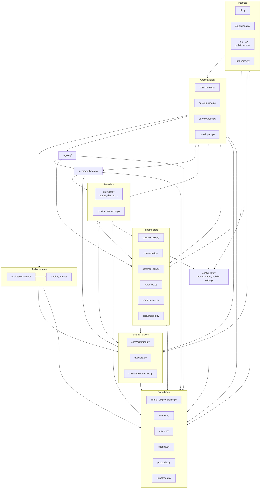

# Architecture

[](https://gitdiagram.com/trackfetch/trackfetch?utm_source=readme&utm_medium=picture)

TrackFetch used to be one `trackfetch.py` module. It is now a small package
with one responsibility per module. The public API is still available from
`import trackfetch`, so the console script and existing integrations keep
working.

## Module map

The package is organized in layers. Old top-level module paths were removed;
import the focused module directly or use the public facade (`import
trackfetch`), which re-exports the documented names.

```
trackfetch/
├── __init__.py          Public facade and re-exports
├── __main__.py          python -m trackfetch
├── _lazy.py             Lazy name/submodule maps for the facade
├── cli.py               Parser composition, help setup and entry point
├── cli_options.py       Argument groups and option definitions
├── errors.py            TrackFetchError hierarchy (config, tagging, cover)
├── enums.py             AudioFormat / MusicSource str-enums
├── protocols.py         AudioSource / Tagger runtime-checkable protocols
├── scoring.py           Frozen dataclasses for candidate scoring
├── audio/
│   ├── youtube/         Search, scoring, age probe, download
│   └── soundcloud/      Fallback search, matching, selection, download
├── config_pkg/
│   ├── constants.py     Defaults, provider tables, regexes
│   ├── model.py         SourceConfig and source-list formatting
│   ├── validate.py      Source-name/boolean/interval validation
│   ├── loader.py        Settings and CLI value resolution
│   ├── builder.py       build_source_config
│   ├── config.py        Re-export facade for the modules above
│   └── settings.py      Config-file discovery and CLI/config precedence
├── core/
│   ├── context.py       RunContext: immutable per-run settings
│   ├── result.py        Result: success/skip/fail outcome of one song
│   ├── reporter.py      Exact per-song progress lines
│   ├── inputs.py        Input discovery, deduplication and output setup
│   ├── runner.py        run_songs: download loop, done/failed logs, summary
│   ├── dependencies.py  Startup check for ffmpeg and ffprobe
│   ├── sources.py       AudioSource implementations and registry
│   ├── pipeline.py      One-song orchestration
│   ├── runtime.py       Health tracking, rate limiter, cache, HTTP session
│   ├── matching.py      Normalization, similarity and candidate scoring
│   ├── images.py        Cover detection, download, Pillow normalization
│   └── files.py         Filenames, song parsing, done/failed logs
├── metadata/
│   └── lyrics.py        LRCLIB lookup, LRC parsing and sidecar writing
├── tagging/
│   ├── __init__.py      get_tagger factory and legacy add_metadata
│   ├── mp3.py           ID3 writer
│   ├── m4a.py           MP4 atom writer
│   └── opus.py          Vorbis-comment writer
├── ui/
│   ├── colors.py        Theme selection and ANSI rendering
│   ├── palettes.py      Built-in color palettes
│   ├── themes.py        Custom themes.ini discovery and parsing
│   └── helpfmt.py       Custom help formatter and epilog styling
├── providers/
│   ├── spotify.py       Optional Spotify provider
│   ├── itunes.py        iTunes Search API
│   ├── deezer.py        Deezer Search API
│   ├── musicbrainz.py   MusicBrainz + Cover Art Archive
│   ├── vocadb.py        VocaDB
│   ├── search.py        Shared query relaxation and candidate deduplication
│   ├── duration.py      Millisecond/second duration normalization
│   ├── registry.py      name -> provider function
│   └── resolver.py      Priority, cooldowns, cache-aware resolution
└── (no top-level compatibility shims)
```

## Dependency direction

Dependencies point in one direction:



Read it top to bottom: each row may use only the rows below it. The
`Interface` row (`cli.py`, `cli_options.py`, the `trackfetch/__init__.py`
facade and `ui/themes.py`) is the only place that knows the whole graph.
`core/runner.py` receives `process_song` as a parameter instead of importing
`cli.py`, so nothing imports upward into the CLI.

`audio/`, `metadata/` and `providers/` reuse the *pure* helpers in
`core/matching.py` and `core/runtime.py` (normalization, similarity, the HTTP
session) and `tagging/` reuses `core/images.py` (image format detection), but
none of them import `core/runner.py`, `core/pipeline.py` or `core/sources.py`.
That is what keeps them testable with plain dictionaries and makes
`providers/registry.py` the only module that knows which metadata providers
exist.

## Design rules

- **One run, one `MetadataRuntime`.** It owns the HTTP session, rate
  limiter, provider health, cache and Spotify client. Providers receive it
  instead of creating module-level clients. The per-run choices (format,
  quality, thresholds, runtime) travel in a frozen `RunContext`; the outcome
  of one song is a frozen `Result`.
- **Errors are typed.** Modules raise `ConfigError`, `TaggingError`,
  `CoverError` or `ProviderError` from `trackfetch/errors.py`; there are no
  bare `except Exception` handlers.
- **Providers return candidates; the resolver decides.** Provider functions
  only translate an API response into the common metadata dict. Thresholds,
  priority, cooldowns and caching live in `providers/resolver.py`.
- **The pipeline is the only place that knows the full download order.**
  Resolve metadata → pick a filename → try the configured music providers in
  priority order → download audio → download cover → embed tags and lyrics →
  move the finished file. With the default `youtube,soundcloud` priority,
  SoundCloud runs once when YouTube fails in the way the trigger allows. With
  `soundcloud,youtube`, SoundCloud is searched first and YouTube is the
  fallback.
- **`audio/soundcloud/` is pure matching plus two yt-dlp calls.** It never
  downloads audio; it returns a ranked, filtered candidate list and the
  pipeline downloads at most one URL. This keeps the scoring testable with
  plain dictionaries and keeps the download order in the pipeline.
- **The CLI never implements domain logic.** It parses arguments, builds a
  `SourceConfig`, creates the runtime and hands the song list to
  `core/runner.run_songs`, which owns the loop, the done/failed logs and the
  summary. Parser options live in `cli_options.py`; `cli.py` composes them.
- **Public names stay re-exported from `trackfetch/__init__.py`.** Tests and
  external code can keep using `trackfetch.normalize(...)`, while new code
  can import from the focused module directly.

## Adding a metadata provider

1. Create `trackfetch/providers/<name>.py` with a function that accepts
   `(runtime, artist, title, config)` and returns a list of candidate dicts.
2. Register it in `trackfetch/providers/registry.py`.
3. Add the provider to `METADATA_PROVIDERS`, `PROVIDER_DEFAULTS` and
   `PROVIDER_OPTIONS` in `trackfetch/config_pkg/constants.py`.
4. Re-export the provider function from `trackfetch/__init__.py` if it
   should be part of the public API.
